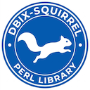

# Planned work

## The README's logo and badges in a =begin markdown block

**From:** Ekorn-Pipeline's session, 2026-11-23 (Ekorn-Pipeline
ba37e15879adfad8c52810dd289b71a17928cf86; the same fix to Ekorn's
README follows that commit)
**Waiting on:** nothing

Iain's change adding the logo to the README, uncommitted in this
working copy when this task was written, puts the logo and the CPAN
and Kwalitee badges after a `=for markdown` line, with a blank line
between:

```pod
=for markdown



[](...) [](...)
```

A `=for` paragraph ends at the first blank line, so this one holds
nothing, and the image tag and the badges are plain POD paragraphs.
`README.md` looks right, as Minilla's Pod::Markdown passes them through
raw, but `perldoc -T README.pod`, and MetaCPAN if it renders the file,
show the tag and the badges' links as text. Ekorn-Pipeline's README had
the same, found by Iain's request for its logo, and Iain asked for
this task.

What to do, as Ekorn's README now does:

- In `README.pod`, put the badges and the logo in a block,
  `=begin markdown` to `=end markdown`, which POD readers skip.
- Put the logo's line straight after the badges' line, with no blank
  line between. Minilla writes its CI badge first, before what
  `README.pod` gives, so a logo first lands between the CI badge and
  the others, and a blank line after it splits the badges into two
  rows. After them, with no blank line, it's in the badges' paragraph,
  and floats right from the top line.

```pod
=begin markdown

[](https://metacpan.org/release/DBIx-Squirrel) [](https://cpants.cpanauthors.org/dist/DBIx-Squirrel)


=end markdown
```

- Generate `README.md` again with `minil build`, and check its first
  line still says `branch=main`.

**Done when:** `perldoc -T README.pod` opens at the DBIx-Squirrel
heading, with no image tag or badge links as text; `podchecker
README.pod` says its syntax is OK; and `README.md`'s first three
lines are the CI badge, the CPAN and Kwalitee badges, and the logo.
